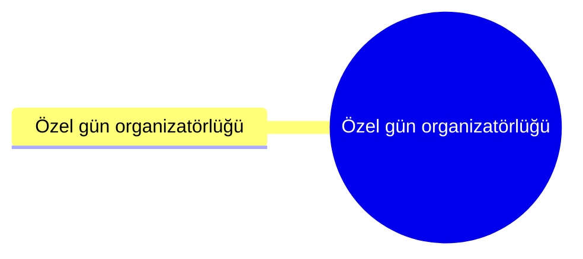

# 16-06 · Özel gün organizatörlüğü

> Sektör: [[16 Etkinlik & Organizasyon]] · 1 alt dal · 31 fonksiyon
> Görsel: [[Ağaç – 16 – Özel gün organizatörlüğü]]

## Özet
- Özel gün organizatörlüğü: onaylı alt işletme tür(ler)i ve bağlanan araç/fonksiyonlar.

## Alt dallar
| # | Alt dal | İşletme sayısı | Fonksiyon | Not |
|---|---|---|---|---|
| A1 | [[Özel gün organizatörlüğü]] | bulunamadı | 31 | Öncelik 3.8 (A) |



## Dalın ortak temeli
- Çekirdek: [[Muhasebe ve Gelir-Gider]], [[e-Fatura ve e-Arşiv]], [[CRM]], [[Personel ve Vardiya]], [[Raporlar]], [[AI Asistan]], [[Ayarlar]]
- Sektör ortak araçlar + bu dalın alt tür araçları

## Fonksiyon matrisi
> ● = kullanıyor.

| Fonksiyon | A1 | Kullanım |
|---|---|---|
| [[Muhasebe ve Gelir-Gider]] | ● | 1/1 |
| [[e-Fatura ve e-Arşiv]] | ● | 1/1 |
| [[CRM]] | ● | 1/1 |
| [[Personel ve Vardiya]] | ● | 1/1 |
| [[Raporlar]] | ● | 1/1 |
| [[AI Asistan]] | ● | 1/1 |
| [[Ayarlar]] | ● | 1/1 |
| [[Etkinlik takvimi]] | ● | 1/1 |
| [[15 Haziran akşam boş mu?]] | ● | 1/1 |
| [[Aynı tarihe iki opsiyon var mı?]] | ● | 1/1 |
| [[Kapora sözleşme]] | ● | 1/1 |
| [[Yılmaz düğününün kaporası geldi mi?]] | ● | 1/1 |
| [[Kalan bakiyeyi hatırlat]] | ● | 1/1 |
| [[Tedarikçi teyidi]] | ● | 1/1 |
| [[Cumartesi ikram teyit etti mi?]] | ● | 1/1 |
| [[Teyitsiz tedarikçiler?]] | ● | 1/1 |
| [[Run-of-show]] | ● | 1/1 |
| [[Akışta 19:00 sonrası ne var?]] | ● | 1/1 |
| [[Kurulum penceresi çakışıyor mu?]] | ● | 1/1 |
| [[Kişi sayısı]] | ● | 1/1 |
| [[Kişi 180'den 220'ye çıktı, ne değişir?]] | ● | 1/1 |
| [[Son kişi güncellemesi?]] | ● | 1/1 |
| [[İş brief]] | ● | 1/1 |
| [[Kına brief'i özetle]] | ● | 1/1 |
| [[Bütçe tavanı aşıldı mı?]] | ● | 1/1 |
| [[Teklif karşılaştır]] | ● | 1/1 |
| [[Üç fotoğraf teklifini karşılaştır]] | ● | 1/1 |
| [[En ucuz ama teyitsiz kim?]] | ● | 1/1 |
| [[Gün checklist]] | ● | 1/1 |
| [[Nikah günü checklist]] | ● | 1/1 |
| [[Eksik teslim kalemi?]] | ● | 1/1 |

## Bu daldaki alt dallar (canlı)
```base
filters:
  and:
    - 'tip == "isletme"'
    - file.hasLink(this.file)
views:
  - type: table
    name: Alt dallar
```
