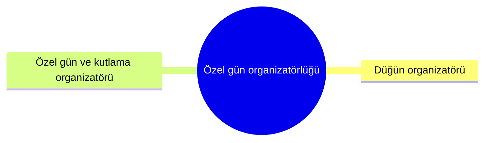

# 16-06 · Özel gün organizatörlüğü

> Sektör: [[16 Etkinlik & Organizasyon]] · 2 alt dal
> Görsel: [[Ağaç – 16 – Özel gün organizatörlüğü]]

## Özet
- Özel gün organizatörlüğü

## Alt dallar
| # | Alt dal | İşletme sayısı | Fonksiyon | Not |
|---|---|---|---|---|
| A1 | [[Düğün organizatörü]] | bulunamadı | 31 | Öncelik 3.8 (A) |
| A2 | [[Özel gün ve kutlama organizatörü]] | bulunamadı | 31 | Öncelik 3.4 (B) |



## Bu daldaki alt dallar (canlı)
```base
filters:
  and:
    - 'tip == "isletme"'
    - file.hasLink(this.file)
views:
  - type: table
    name: Alt dallar
```
