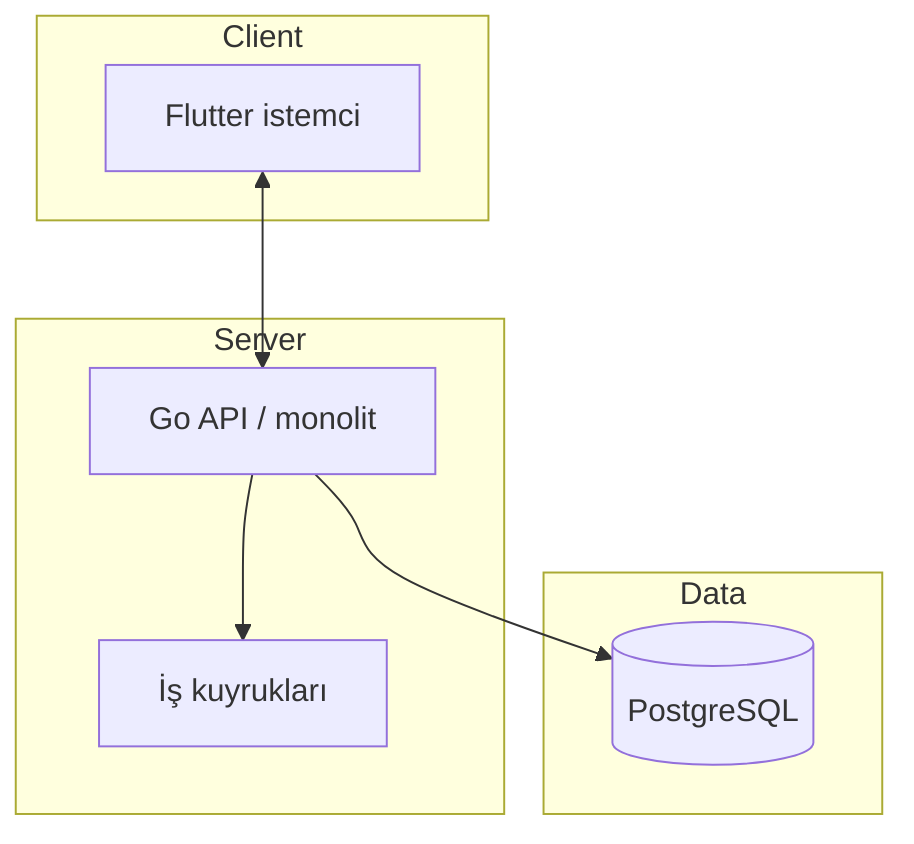

# Xfuturepos – Sistem Mimarisi ve Araştırma Raporu (Keşif)

> Kod içermez. Teknoloji seçimlerinin nedenlerini ve risklerini anlatır. "Tahmin" / "doğrulanmalı" yerler teyit edilmeli.

## 1. Yönetici özeti

### Özet
- Tek ürün, 6 sektör: Emlak, İnşaat, Lojistik, Üretim, Teknoloji/Medya/Ajans, Etkinlik.
- Ürün henüz yok. Araştırma kasası: 39 işletme türü, ortak çekirdek + sektörel araçlar.
- Ana bulgu: altı sektör de **çekirdek araçları** paylaşıyor (Muhasebe, e-Fatura, CRM, Personel, Raporlar, AI Asistan, Ayarlar).
- Plan: önce pilot sektör, sonra aynı çekirdeğe ayar/şablonla genişleme.

### Kararlaştırılmış teknoloji (keşif)
| Katman | Seçim |
|---|---|
| İstemci | Flutter (masaüstü + mobil) |
| Sunucu | Go |
| Veritabanı | PostgreSQL (+ JSONB) |
| Çalışma | Offline-first; internet gelince senkron |
| Yönetim | Web admin panel |
| Yapay zekâ | İleride açık ağırlıklı modelde fine-tuning (sürüm seçimi sonra) |

### Erken uyarılar
1. Offline-first her modülde aynı maliyetle gelmez. e-Belge, ödeme, SMS internet ister → kuyruk.
2. Açık API bulunmayan kurum portalları panel kaydı + kullanıcı girişi ile çözülür; uydurma entegrasyon yok.
3. Yüksek etkili işlem (ödeme, sözleşme, resmi başvuru, müşteri mesajı) onay kuyruğundan çıkar.
4. Başta API Gateway şart değil; modüler monolit yeterli (tahmin).

## 2. Teknoloji seçimi (özet)

### Go
- Tek binary, düşük bellek, eşzamanlı kuyruk işleri doğal.
- Alternatifler (Node, Java, C#, Python) ekip tercihi / ağırlık nedeniyle seçilmedi.

### PostgreSQL
- İlişkisel + JSONB ile sektöre özel alanlar.
- Çok kiracılı şema stratejisi uygulama aşamasında netleşir.

### Flutter
- Tek kod tabanı ile Windows/macOS/Linux/iOS/Android.
- Offline cache ve senkron tasarımı istemci + sunucu sözleşmesine bağlı.

## 3. Sistem katmanları

1. **Sunum** — Flutter ekranları (iş listesi, kart, tahsilat, rapor).
2. **Uygulama** — Go servisleri; sektör farkı ayar/şablon.
3. **Veri** — ortak tablolar + JSONB uzantılar.
4. **Entegrasyon** — e-belge entegratörü, takvim, (varsa) açık API; yoksa manuel portal.

## 4. Araç mimarisi ilkesi
- Araç bir kez yapılır, sektörlere verilir.
- İşletme türü = araç birleşimi (Parçalar tablosu).
- Sektöre özel araç yalnız küçükse ve satışın ön şartıysa.

## 5. Güvenlik ve KVKK
- Aydınlatma / rıza / erişim günlüğü.
- Özel nitelikli veri işleyen sektörlerde (varsa) ek önlem.
- LLM’e ham kişisel veri gönderme politikası uygulama öncesi yazılır.

## 6. Pilot önerisi (tahmin)
Öncelik tablosunda A harfli ve çekirdekle kurulan türler. Kesin pilot kullanıcı kararıdır.

## 7. Açık sorular
- Pilot sektör hangisi?
- e-Belge entegratörü hangisi? (Mikro uçları arşivde doğrulanmıştı)
- Offline kapsamının sınırları?

## Kaynaklar
- Araştırma kasası: `01 Sektörler/` · `02 İşletmeler/` · `04 Modüller/`
- [[Araştırma Planı]] · [[Doğrulama – Faz D]]
